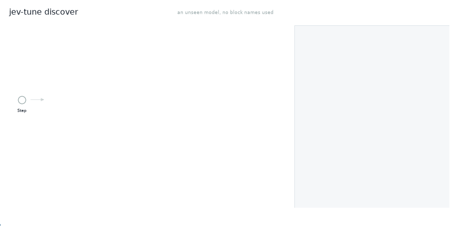
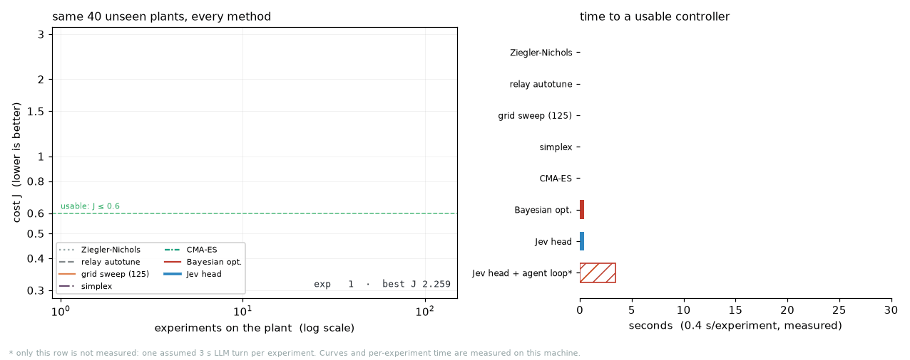
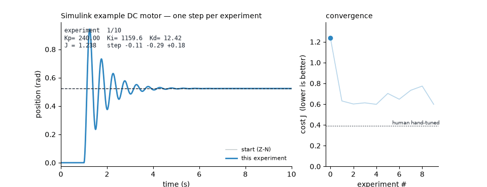
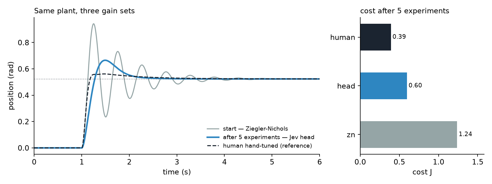
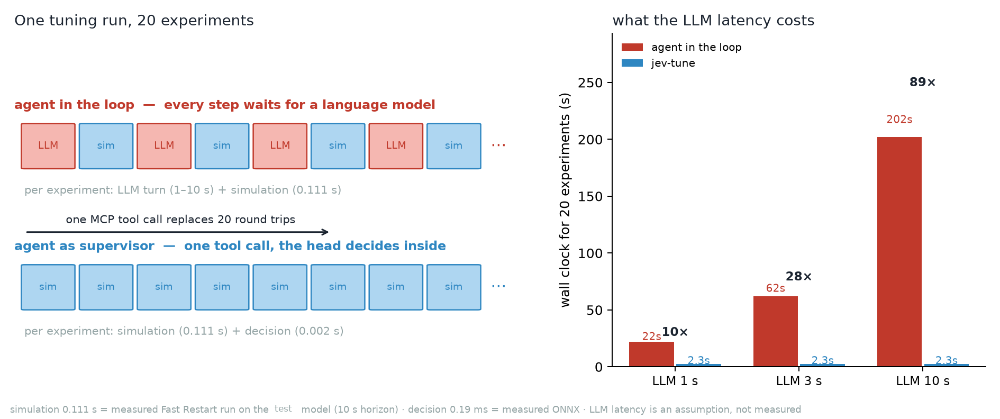

[English](README.md) · [简体中文](README.zh-CN.md)

**Agent checkout:** use the [lightweight Git clone commands](docs/DISTRIBUTION.md#reuse-the-framework)
before the first clone, then read `AGENTS.md`. They retain all formal weights without downloading research records.
**Download for reuse:** [v0.10.1 source ZIP](https://github.com/lijiawei255/jev-tune/archive/refs/tags/v0.10.1.zip)
keeps the complete implementation, tests, documentation and formal weights.
Experiment records are optional [Release attachments](https://github.com/lijiawei255/jev-tune/releases/tag/v0.10.1),
with SHA-256 verification and automatic restoration. See [downloads and reproduction](docs/DISTRIBUTION.md).
Ordinary Git clones still include the retained research records and history.

<!-- transfer-shell:en:start -->
**Scope: a decomposable Calibrated Decision & Safety Shell with a PID testbed.** A new non-PID offline denoising task includes three genuinely trained models and independent testing; policy-benefit acceptance is `negative_stop`. At budget20, learned mean MSE spans 0.01555577–0.01582834, versus simplex 0.01423997. Stable benefit was not established; this policy investigation stops. Prospective acquisition used 76683 objective calls; standalone training/calibration labels cost 27345 per model. Negative raw evidence, frozen protocols and reproduction remain available; complex risk research stays paused.

Using 16, 32 or 64 labeled states in EACH independent temperature/CP split (32, 64 or 128 total), the nine host fit-time medians span 4.601500–5.744300 ms. Label acquisition, inference, communication and device execution are excluded. This does not validate cross-day, VLA, clinical or target-board operation. The non-PID study did not replace the PID model or default policy; this release separately hardens C/MATLAB input and numeric handling. The C99 checked entry rejects invalid states/temperatures/policies and numeric failures, clears stale actions and holds every axis. Default CP retains complete monitor sets; explicit hard_hold can veto before actuation. Post-measurement rollback is domain-owned recovery, not a physical-safety proof.

Numerical replay scope: the original strict 46/48 checks passed on the original machine and failed across CPUs; those failures remain preserved. A local pass is not a cross-CPU pass. The separate 52 audit checks original-record evidence under explicit arithmetic assumptions and reconstructs its action chain from independently checked recorded probabilities. It does not recover bitwise replay, prove the causal history of training, or promise equivalent actions or trajectories across CPUs. The diagnostic step delta applies both archived logits/T inputs to the original comparison machine's decoder; it is not a difference between actions actually executed on two machines. Strict recomputation of 54's derived floating summaries also failed in the default hosted environment. New 57/58 preserve and independently audit post-incident observations from both default environments; they do not turn 54's failure into a pass or establish future backend identity.

See [shell and transfer boundaries](docs/SAFETY_SHELL.md), [complete non-PID evidence](docs/NONPID_TRANSFER.md), [small-sample recalibration](docs/RECALIBRATION.md), [numerical reproducibility and evidence boundaries](docs/NUMERICAL_REPRODUCIBILITY.md), [post-incident observation audit](docs/RUNTIME_OBSERVATIONS.md), and [host resources](docs/COMPUTE.md).
<!-- transfer-shell:en:end -->

# jev-tune

<!-- practical-mainline:en:start -->
**Current mainline: real-model adaptation, applicability boundaries and simulation-budget value.**
Deeper joint-risk research is paused. Its failed acceptance, raw trajectories, frozen protocols and reproduction scripts remain available; the risk head stays in research mode and is not enabled in production. Complete CP sets and their existing coverage boundaries remain unchanged.
On the current checkout, use `python scripts/44_verify_historical_research.py --check` to verify the frozen research against an isolated historical source view. Original study commands remain available on v0.8.0; they must not silently substitute today's repaired runtime for their recorded sources.

The practical audit prioritizes controller equivalence, unambiguous measurements, time-based costs, truthful failure status and complete simulation accounting. See [MODEL_ADAPTATION](docs/MODEL_ADAPTATION.md) and [PRACTICAL_BUDGET](docs/PRACTICAL_BUDGET.md). Generated Simulink fixtures validate adapter behavior; they do not establish performance on an unseen external model or physical hardware.

Earlier MATLAB cost figures, traces and animations below are historical: the corrected time-grid integration changes that objective. They are retained as records, not current performance measurements.
Cross-job model/sweep caching is disabled to preserve each source model and configuration; historical warm-job throughput tables do not describe the current implementation.
<!-- practical-mainline:en:end -->


[](https://github.com/lijiawei255/jev-tune/actions/workflows/ci.yml)
[](LICENSE)
[](pyproject.toml)
[](docs/SCALE.md#4-matlab-versions)
[](docs/COMPUTE.md)
[](docs/STEP1_RESULTS.md)
[](docs/SCALE.md#4-matlab-versions)
[](CONTRIBUTING.md)
[](README.zh-CN.md)

**PID autotuning with typed probabilistic decisions and explicit abstention.**
The numeric head uses one CPU forward pass. Complete CP sets are monitored independently of actuation.
Hard Hold is an explicit comparison policy; unchanged deterministic trials stop without repeated simulation.

> **Jev-inspired, not affiliated.** It uses the *Jev interface* — the three typed
> primitives `choice` / `score` / `noul` with calibrated probabilities — not the
> hosted Jev model or Laya's 421 M text encoder. The runtime policy is a 200 KB
> numeric head trained in this repo; Laya is only mentioned as a text baseline
> that was never wired in. This project is **not affiliated with, endorsed by, or
> sponsored by TypeSafe AI**. What is borrowed and what is not:
> [`docs/JEV_MAPPING.md`](docs/JEV_MAPPING.md).

## Let your agent do it

If you use a coding agent (Claude Code, Codex, OpenCode, Cursor — anything that
can run a shell), you do not need the rest of this file. Paste one sentence,
with your own model path:

> **"Use github.com/lijiawei255/jev-tune to tune the PID gains in
> `C:\work\MyMotor.slx`, then show me the before/after curve."**

The agent reads [`AGENTS.md`](AGENTS.md), which tells it to run `jev-tune
discover` first. Discovery follows the signal graph — not block names — to find
the gains, the measured signal and the reference, then confirms the guess with
confirmation simulations whose attempts are included in the discovery ledger:

```bash
jev-tune discover --model MyMotor.slx --json      # what the agent runs first
jev-tune matlab --model MyMotor.slx --auto --plot before_after.png --write-back
```

No block renames, no scope called `Scope_Position`, no reference typed by hand.
When the model is ambiguous the command says `confidence: medium` instead of
guessing, and the agent asks you one question.

If something refuses or fails, `jev-tune doctor --model <file>` explains why in
nine lines — does it load, does it compile, does it use referenced or protected
models, what solver, can a loop be found at all:

```console
$ jev-tune doctor --model MyMotor.slx
check       ok?   detail
file        ok    MyMotor.slx (95 KB)
loads       ok    MATLAB 2024b
referenced  ok    none
protected   ok    none
stateflow   ok    none
compiles    FAIL  Unrecognized function or variable 'Tsim'.
                  -> define the variables the model asks for, then run it once
solver      ...
```

**Several loops in one model?** Independent loops (four axes, three zones) are
tuned one after another with `--all-loops`. A **cascade** is refused on purpose:
`cascade_suspect` comes back with the loops it found, because tuning one loop of
a cascade and reporting success would be worse than saying so. See
[`docs/APPLICABILITY.md`](docs/APPLICABILITY.md#several-loops-in-one-model).



*The animation uses this project's generated model and actual graph/discovery
records. It shows the error junction, gain-path classification and confirming
perturbation simulations. It contains no benchmark structure or screenshot.
The public inputs and regeneration recipe are listed in
[`OPEN_SOURCE`](docs/OPEN_SOURCE.md).
Regenerate with `scripts/15_make_discovery_gif.py`.*

## Where to read next

| I want to… | go to |
| :--- | :--- |
| see it run in a minute | [Try it](#try-it) |
| watch a full run, with real output | [`docs/EXAMPLES.md`](docs/EXAMPLES.md) |
| know why my model will not tune | `jev-tune doctor --model <file>` |
| know whether my model qualifies | [`docs/APPLICABILITY.md`](docs/APPLICABILITY.md) |
| understand the decision contract | [`docs/ARCHITECTURE.md`](docs/ARCHITECTURE.md) |
| see what is borrowed from Jev, and what is not | [`docs/JEV_MAPPING.md`](docs/JEV_MAPPING.md) |
| know whether the typed path actually helps | [`docs/ABLATION.md`](docs/ABLATION.md) |
| know what "hold when unsure" costs | [`docs/ABSTENTION.md`](docs/ABSTENTION.md) |
| check the compute numbers (MACs, RAM, int8) | [`docs/COMPUTE.md`](docs/COMPUTE.md) |
| borrow the pattern for another domain | [`docs/TRANSFER.md`](docs/TRANSFER.md) |
| check how the budget is accounted | [`docs/BENCHMARK.md`](docs/BENCHMARK.md) |
| check the numbers myself | [`docs/STEP1_RESULTS.md`](docs/STEP1_RESULTS.md), [`docs/STEP4_RESULTS.md`](docs/STEP4_RESULTS.md), [`docs/CLAIMS.md`](docs/CLAIMS.md) |
| drive it from an agent or MCP | [`AGENTS.md`](AGENTS.md) |
| handle a plant family it has not seen | [`docs/SPECIALIZE.md`](docs/SPECIALIZE.md) |
| run hundreds of models | [`docs/SCALE.md`](docs/SCALE.md) |
| compare honestly with `pidtune` | [the pidtune section](docs/APPLICABILITY.md#if-you-already-have-an-accurate-model-use-pidtune) |



*Seven ways to tune the same 40 unseen plants. **Every number is measured**:
median cost after N experiments from one run of `scripts/12_make_race.py`, and
the right panel asks the question that matters — how long until the controller
is usable (J ≤ 0.6) — at 0.4 s per experiment. The hatched row is an agent with a
hosted model in the loop: its turn took a measured **5.3 s median** (GLM-5.3-Flash,
40 calls, 13 of them unparseable). Hand tuning has no curve on purpose — it
produces a single gain set after hours, not a series of experiments.*



*Historical run under the earlier objective and sweep; see the corrections in
[`STEP4_RESULTS`](docs/STEP4_RESULTS.md). Every frame is one recorded closed-loop experiment on the lab
DC-motor model in Simulink. The tuner is choosing `Kp`, `Ki`, `Kd` itself; the
right panel is the cost it is minimising. The best gains appeared after five
experiments (~0.55 s of simulation); the stall detector stopped the loop at nine.*

---

See [Temperature + Split CP](docs/CONFORMAL.md) for the independent calibration results and precise coverage limits. Historical CP hard-hold costs are worse than the temperature-only control; default monitor preserves the temperature-only proposal; neither a label-coverage theorem nor a hold certifies closed-loop safety.

<!-- joint-risk-rollout:start -->
**Joint-action risk rollout acceptance: not passed.** On <!-- claim:joint_rollout_n -->1024<!-- /claim --> independent test plants under the frozen protocol, <!-- claim:joint_rollout_any_harm -->2<!-- /claim --> gated trajectories contained a harmful execution; the nominal exact-binomial one-sided 95% upper quantity is <!-- claim:joint_rollout_risk_upper -->0.006135<!-- /claim -->. Gated/matched-monitor final mean J is <!-- claim:joint_rollout_gated_mean -->2.303682<!-- /claim -->/<!-- claim:joint_rollout_monitor_mean -->1.297619<!-- /claim -->, and p90 is <!-- claim:joint_rollout_gated_p90 -->3.416603<!-- /claim -->/<!-- claim:joint_rollout_monitor_p90 -->2.314045<!-- /claim -->. The nominal one-sided 95% lower quantity for first-stage execution is <!-- claim:joint_rollout_first_lower -->0.479684<!-- /claim -->; its preregistered minimum is 0.50. See [JOINT_RISK_ROLLOUT](docs/JOINT_RISK_ROLLOUT.md) for every criterion, independent stage calibration, raw trajectories and scope. This preserves the v1 numerical record; calculating binomial quantities does not itself establish independence of implemented trajectory events. This does not enable a joint-risk gate by default in general Python, C or MATLAB deployment; failed criteria are not hidden by retuning thresholds.
<!-- joint-risk-rollout:end -->

<!-- trajectory-risk-v2:en:start -->
### Multistep joint risk: new preregistered study FAIL

The sole primary candidate is `trajectory_selected`; status is `research_only`. On 1024 new independent test plants, 8 trajectories had a harmful execution. The nominal one-sided 95% binomial risk upper bound is 0.014052; the nominal first-execution lower bound is 0.559971. Implementation assumptions are audited below. Primary/matched-monitor final mean J is 2.158651/1.357796, p90 J is 3.149694/2.294926, and actual operating simulations are 2770/21504. Failed criteria: final mean cost noninferiority (`empirical_mean_cost_noninferior`); final p90 cost noninferiority (`empirical_p90_cost_noninferior`). Final mean and p90 are compared with monitor with zero slack; reducing harmful exploration alone does not pass the complete acceptance.

The v1 failure is preserved. Old tests have been used for retrospective diagnosis and cannot independently validate the new design. Only the primary candidate fixed before data is assessed for acceptance on the new test; explanatory arms cannot be selected for deployment after testing. The new comparison changes training trajectories, data volume, scaling and initial risk-feature semantics together; it is not a single-factor causal experiment.

On the recorded old paths, preserving the monitor optimum requires a harmful transition for 700/1024 plants. Thus a gate that only truncates those paths cannot meet both the original risk and zero-slack mean criteria. This is a finite-record diagnosis, not an impossibility theorem for all new policies. Alternative joint actions can change paths; their success is decided by the measured new acceptance.

See the [old failure diagnosis](docs/ROLLOUT_DIAGNOSIS.md), [full new study](docs/TRAJECTORY_RISK.md), and their JSON/raw shards. General Python/C/MATLAB deployment defaults remain unchanged. Passing numerical criteria alone cannot bypass the separate implementation-validity audit or expand the registered runner, population and horizon.

**Additional implementation-validity audit: NOT ESTABLISHED; deployment_allowed=false.** Frozen numerical criteria and this audit are separate. Observed dependence on batch shape/row position leaves a canonical per-object mapping, calibration/test CP-score exchangeability, and independence of trajectory events unestablished in this run. The CP and one-sided 95% binomial quantities are therefore nominal calculations, not established exact CP/PAC guarantees for this machine implementation. A generic exchangeability disclaimer does not close this gap. This is an additional failure beyond the frozen numerical acceptance; deployment remains prohibited. A fixed inference mapping, fresh calibration and new prospective validation are required. See the [implementation-validity audit](research/results/trajectory_risk_validity.json).

Pairing fixes initial plants and observations; it does not require bitwise-identical cross-arm proposals or histories under different active batch layouts. Each arm retains its own actual actions, strict zero-tolerance labels, CP sets and history accounting; no new acceptance tolerance is fitted to test differences. Strict scientific-evidence reconstruction and exact canonical-record replay are verified within the recorded reference environment; Python/C99 runtime portability does not imply bitwise reproduction of study trajectories across platforms. See the [release verification scope](docs/RELEASE_VERIFICATION.md). [Pairing diagnosis](research/results/trajectory_risk_pairing_diagnosis.json). The [Fixed-input batch diagnosis](research/results/batch_inference_diagnosis.json) charges 1 additional diagnostic simulations. Repeating identical inputs at different batch shapes/row positions gives a maximum base_step difference of 1.24583552e-07. This is a post-hoc numerical mechanism check, not reconstruction of the full original cohort or new independent acceptance; recorded actions and boundaries remain unchanged.
<!-- trajectory-risk-v2:en:end -->

## The 15-second version

| | |
| :--- | :--- |
| **What it does** | picks the next PID gain step from the measured response and records probability/set diagnostics |
| **How fast** | ONNX forward <!-- claim:decision_ms -->0.022<!-- /claim --> ms median; Python default typed/abstention path <!-- claim:typed_decision_ms -->0.375<!-- /claim --> ms median, <!-- claim:typed_decision_p99_ms -->1.230<!-- /claim --> ms p99. Host timing, not WCET; see [COMPUTE](docs/COMPUTE.md). |
| **Historical MATLAB run** | **5 experiments** on the lab motor cut the recorded cost from **1.238 to 0.598** in v0.2. These are historical measurements under the old objective, not a current rerun; neither the earlier sweep repair nor the v0.9 time-grid correction updates those numbers. See [STEP4_RESULTS](docs/STEP4_RESULTS.md). |
| **How it generalises** | Historical validation median 0.482; frozen thermal median 1.833. Their baselines and oracle priors are shown below; the separate v0.9 fixed-start comparison is in [PRACTICAL_BUDGET](docs/PRACTICAL_BUDGET.md). |



*Historical v0.2 illustration under the old cost definition, not a current rerun.
Same plant, three gain sets. Grey: the Ziegler-Nichols start. Blue: after five
experiments. Dashed: the lab's hand-tuned solution. That run started from a
Ziegler-Nichols estimate produced by the Ku sweep as it was in v0.2; the sweep
was wrong in three ways and has since been fixed — see the correction in
[`docs/STEP4_RESULTS.md`](docs/STEP4_RESULTS.md#correction-the-ku-sweep-was-wrong).*

---

## Why this is different

**vs. LLM-agent tuning.** An agent loop ("read the plot → write a paragraph →
parse the answer") costs seconds per iteration, and the number is buried in
prose. Here the model emits three Jev primitives — `choice` for the step,
`score` for "how good is this response", `noul` for "is this step safe" — so the
decision is a probability vector you can log and calibrate. Optional hold
policies are evaluated in [ABSTENTION](docs/ABSTENTION.md); default CP monitoring
does not veto a proposal. Calibration targets and limits are defined in
[CONFORMAL](docs/CONFORMAL.md), not a calibrated probability of safe execution.

**vs. classical autotune.** Ziegler-Nichols and relay autotuning give you one
shot with no feedback. This keeps iterating, and it learns the *policy* once
across a whole family of plants, so a new plant needs no re-tuning of the tuner.

**Comparison with ordinary heads and optimizers.** Current matched-split regression/argmax controls are in [ABLATION](docs/ABLATION.md). One training checkpoint and three evaluation draws do not establish a general causal advantage of the type interface. The gate, calibrated thresholds and matched-coverage random hold are reported separately.

The fixed-start comparison in [PRACTICAL_BUDGET](docs/PRACTICAL_BUDGET.md) reports
returned cost and actual calls together. Results depend on the plant and prior;
the head does not outperform the classical baselines across all groups or metrics.

**Why not just `pidtune`?** With a suitable linear model, include `pidtune` as a
baseline and validate the controller on the full model. The historical
identify→`pidtune` experiment is a separate workflow, with failure limitations
documented in [BENCHMARK](docs/BENCHMARK.md). An accurate model does not guarantee
that its default design minimizes this repository's cost.

**When your plant is outside the training zoo** the head is not magic: it fails
on dead bands, inverse response and open-loop unstable plants (documented in
[`docs/GENERALIZATION.md`](docs/GENERALIZATION.md)). First compare it with bounded
classical search under the same actual simulation allowance. A **specialist** is
an optional separate study, not a guaranteed repair:

```bash
python scripts/10_specialize.py --scenario valve_dead_zone --name valve
```

Specialization uses offline simulation and can also degrade held-out performance. Current measured artifacts and the withdrawn historical provenance explanation are documented in [SPECIALIZE](docs/SPECIALIZE.md).

---

## Try it

### Human

```bash
git clone https://github.com/lijiawei255/jev-tune && cd jev-tune
conda create -n jev-tune python=3.12 -y && conda activate jev-tune
pip install torch --index-url https://download.pytorch.org/whl/cpu
pip install -e .
jev-tune demo            # 12 held-out plants, head vs CMA-ES vs Z-N, ~20 s
```

Then, on **your** model, run the doctor before the tuner. It takes ~40 s (almost
all of it MATLAB starting) and answers the question that decides everything else:
can this model be tuned at all?

```bash
jev-tune doctor  --model C:/path/YourModel.slx          # loads, compiles, solver, loop
jev-tune matlab  --model C:/path/YourModel.slx --auto --plot before_after.png
```

If the `compiles` line fails, nothing downstream will work and it names the
missing workspace variable; if `tunable` fails, the reason is in that line and in
`--json`. Nine checks, one line each — see
[`docs/EXAMPLES.md`](docs/EXAMPLES.md) for the real output.

**Clone, do not `pip install jev-tune`.** The MATLAB bridge (`matlab/*.m`) and
the trained weights (`models/`, 600 KB) travel with the repository, so a wheel
from PyPI would be an incomplete package — the command would run and then fail
to find the thing that does the work. The repository *is* the distribution unit;
nothing here needs PyPI, Docker or a GPU. If `git clone` is slow on your
network, the green **Code → Download ZIP** button gives the same tree.

### Agent

Point your assistant at [`AGENTS.md`](AGENTS.md). The short form:

```bash
bash scripts/agent_setup.sh            # idempotent, no prompts
python -m jev_tune.cli status --json   # exit 0 = ready, 2 = exact fix printed
python -m jev_tune.cli discover --model YourModel.slx --json
python -m jev_tune.cli matlab --model YourModel.slx --auto --json
```

Or register the MCP server so the agent can call it as a tool:

```jsonc
{ "mcpServers": { "jev-tune": { "command": "jev-tune-mcp" } } }
```

Tools exposed: `tune_status`, `tune_probe_matlab`, `tune_doctor`, `tune_discover`,
`tune_simulink`, `tune_apply_gains`, `tune_demo`. `tune_doctor` explains a refusal;
`tune_discover` tells the agent which blocks are the controller and which signal
is measured;
`tune_simulink` returns the final gains, the cost at every experiment and the
rollback count. One tool call instead of twenty.



*Historical illustration: 0.111 s simulation and 0.19 ms forward-only timing; current full-decision measurements are in docs/COMPUTE.md;
the LLM latency is an assumption and labelled as such. Where the two speedups
in the table come from (122 s → 8.8 s, 60 s → 2.7 s), and how it scales to
hundreds of plants:
[`docs/SCALE.md`](docs/SCALE.md).*

### On your own Simulink model

```matlab
addpath('matlab');
R = jev_tune_model('path/to/YourModel.slx', 'work_dir', 20, 10, 2.5);
```

With `--auto` the block names do not matter: discovery follows the signal
graph to find the controller, the measured signal and the reference, and taps a
logging Scope on a copy if the model has none. Without `--auto` it expects
root-level `Gain_Kp`/`Gain_Ki`/`Gain_Kd` and `Scope-*` blocks. Fast Restart is
enabled for you; the decision runs in-process in MATLAB, with no Python
dependency at runtime.

### No MATLAB? Tune a transfer function instead

```bash
jev-tune loop --num 1 --den "1 0.6 1" --delay 0.02
```

Same head, same decision contract, a different plant adapter: the experiment is
an ODE integration instead of a Simulink run. It is also what CI exercises on
every push, so the decision path is never only tested through MATLAB.

---

## How a step works

```
plant / Simulink  ──►  response (t, y, u)
                          │
                          ▼
              20 features + 2×64 traces           ← overshoot, rise, settling,
                          │                         IAE/ITAE, saturation, and
                          ▼                         the previous action + its result
        ┌─────────────────────────────────┐
        │  decision head (~200 KB, ONNX)  │
        │  choice ×3   score   noul       │
        └────────────────┬────────────────┘
                         ▼
   expected-value decode + variance trust region      ← uncertain ⇒ small step
                         ▼
   deterministic safety gate (bounds, rollback)       ← `noul` is advice only
                         ▼
                 new Kp, Ki, Kd
```

More detail: [`docs/ARCHITECTURE.md`](docs/ARCHITECTURE.md).

---

## Historical throughput measurements

These measurements describe the earlier implementation with cross-job model
and Ku-sweep caching. That caching is now disabled; these figures and derived
job totals are historical records, not current throughput promises.

| historical setup | recorded 20-iteration job time |
| :--- | ---: |
| agent in the loop (LLM 3 s/turn) | 60 s |
| **one CLI process per job** | **122 s** ← 50 s startup + 24 s setup + 39 s Kp sweep + 8 s loop (without `--auto`) |
| earlier warm worker (model and sweep cached) | **8.8 s** |
| long-lived MATLAB session | **2.7 s** |

The current worker can keep MATLAB running but repeats model setup and the
sweep for each job. Its current throughput needs fresh measurement. `iters`
limits tuning-loop iterations; discovery, probing and verification can add
simulations. Read `n_total_simulations` for actual attempts.

| jobs | agent in the loop | one process each | warm worker |
| ---: | ---: | ---: | ---: |
| 100 | 1.7 h | 3.4 h | **15 min** |
| 1 000 | 17 h | 34 h | **2.5 h** |

The historical per-job measurements were taken on the reference machine; the
LLM latency and scaled job totals are assumptions/extrapolations. Historical
breakdown, current caveats and version matrix:
[`docs/SCALE.md`](docs/SCALE.md).

## Benchmarks

**Validation family: two_mass, 120 plants.** Historical benchmark used for design decisions. Iterative methods have a maximum budget of 20; one-shot methods report actual runs. The table's iterative counts are allocated caps, not measured calls after early stopping. All analytic-start methods share oracle Ku/Tu; sweep failures use a fixed non-oracle fallback.

| method | median J | p90 J | maximum budget / one-shot actual |
| :--- | ---: | ---: | ---: |
| `jev_head` | 0.482 | 1.030 | 20 |
| `bo` | 0.547 | 1.552 | 20 |
| `jev_head_swept` | 0.510 | 1.014 | 20 |
| `shrunk_zn` | 1.290 | 1.905 | 1 |
| `identify+pidtune_PID` | 0.742 | 1.705 | 2 |
| `swept_zn` | 1.860 | 2.791 | 8 |
| `vocab_hill` | 1.463 | 2.212 | 20 |
| `cmaes` | 1.723 | 2.521 | 20 |
| `simplex` | 2.037 | 2.879 | 20 |
| `zn_classic` | 2.322 | 3.082 | 1 |

**Frozen thermal family: 120 fixed-grid plants.** Frozen after training and re-evaluated during earlier correctness repairs, without selecting a new checkpoint on it. This is not a preregistered prospective test.

| method | median J | p90 J | maximum budget / one-shot actual |
| :--- | ---: | ---: | ---: |
| `vocab_hill` | 1.711 | 2.447 | 20 |
| `jev_head_swept` | 1.785 | 3.800 | 20 |
| `jev_head` | 1.833 | 2.816 | 20 |
| `bo` | 1.878 | 2.684 | 20 |
| `cmaes` | 2.000 | 2.879 | 20 |
| `identify+pidtune_PID` | 2.330 | 3.064 | 2 |
| `zn_classic` | 2.682 | 3.374 | 1 |
| `swept_zn` | 3.580 | 5.334 | 8 |
| `shrunk_zn` | 4.854 | 5.158 | 1 |
| `simplex` | 2.302 | 3.146 | 20 |

These frozen rows are separate from the v0.9 [practical budget study](docs/PRACTICAL_BUDGET.md), which reports actual calls and does not show uniform head superiority. Historical identify→pidtune rows retain their original implementation's failure limitations. See [BENCHMARK](docs/BENCHMARK.md) for accounting and [raw tables](research/results/benchmark_table_thermal_deadtime.md) for sweep recovery/fallback details.

**Historical Simulink model result (lab DC motor, old objective)**

This table preserves the v0.2 record. It is not a v0.9 rerun and cannot be
compared numerically with the corrected time-grid objective.

| gain set | Kp | Ki | Kd | cost |
| :--- | ---: | ---: | ---: | ---: |
| Z-N start | 240 | 1160 | 12.4 | 1.238 |
| **Jev head (best at experiment 5)** | 90.7 | 160.9 | 15.5 | **0.598** |
| human hand-tuned | 280 | 300 | 30.0 | 0.393 |

Full numbers, caveats and reproduction: [`docs/STEP1_RESULTS.md`](docs/STEP1_RESULTS.md),
[`docs/STEP4_RESULTS.md`](docs/STEP4_RESULTS.md).

---

## What is not tested

The following are two of the project's unmeasured comparisons. They are listed here so nobody has
to infer the boundaries from the benchmark:

| not tested | why it matters | what would close it |
| :--- | :--- | :--- |
| **A language model that is not on the network** | The only language baseline is a hosted API — 5.34 s per turn, 13 of 40 answers unparseable — which mixes the language layer with the round trip and the parsing | a local 1.5B–4B model in the same loop |
| **An external user** | Every model in the benchmarks is ours. "You can point it at your project" is a design goal with a test suite behind it, not something observed | one colleague's model |

The typed-interface question used to be on this list. It is now measured:
[`docs/ABLATION.md`](docs/ABLATION.md) compares the shipped head with a
same-size regression head and with every intermediate decode, all at 20
experiments. The answer is in that file, including where the typed path does
*not* help.

## Related work

The lineage this project sits in, with the caveat that it cites them as context,
not as validation of anything measured here:

* **Jev / TypeSafe AI** — the `choice` / `score` / `noul` interface and the idea
  of a calibrated, typed answer instead of generated text
  ([architecture](https://www.jevtypesafeai.com/jev/architecture)). This
  repository borrows the interface, not the model.
* **Laya / Convai Innovations** — a 421 M open typed-decision assessor, used here
  only as the published calibration reference (ECE 0.466 as shipped) and as the
  text baseline that was planned but never wired in.
* **Early neural PID tuning** — Ruano (1992) and the neural/iterative-relay line;
  Leva & Piroddi (ACC 2004). These establish that a learned mapping from response
  to gains is an old idea; what is new here is the typed-decision interface and
  the calibration/abstention story, not the idea of learning to tune.
* **Reinforcement-learning tuning** — including the stability-preserving RL
  tuning line and the industrial RL-tuning patents (US 10,915,073,
  US 11,307,562). Those optimise a policy end to end; this predicts one bounded
  step from a small labelled dataset.
* **Runtime assurance** — the Simplex architecture (Seto, Krogh, Sha & Chutinan,
  ACC 1998) and shielding (Alshiekh et al., AAAI 2018). The deterministic gate in
  `evaluate.py` is a primitive version of the same idea.
* **Calibration and abstention** — temperature scaling (Guo et al., 2017),
  selective prediction (Geifman & El-Yaniv, NeurIPS 2017), conformal risk control
  (Angelopoulos et al., arXiv:2208.02814). `docs/ABSTENTION.md` measures the
  coverage/cost trade-off; it implements only per-axis marginal teacher-label split CP under exchangeability; this is not a closed-loop safety guarantee.

## Repository layout

```
src/jev_tune/
  primitives.py  Choice / Score / Noul           (domain-agnostic shell)
  decision.py    protocol + concrete PID backend, T/CP loading
  decode.py      numeric expectation, shrink, CP/legacy abstention
  evaluate.py    PID budget accounting, gate, trace, CP adapter   (PID loop)
  plants.py      plant zoo + vectorised closed-loop simulation    (PID testbed)
  metrics.py     response -> scalar cost                          (PID testbed)
  state.py       20 features + 2x64 traces                        (PID testbed)
  expert.py      coordinate line search over the vocabulary       (PID testbed)
  model.py       the decision head and the lookahead value net
  train.py       dataset -> head
  baselines.py   Z-N, swept Z-N, shrunken Z-N, relay, hill climb, simplex, CMA-ES, BO
  identified.py  identify -> pidtune (the practitioner baseline)
  discover.py    find the gains, signal and reference of an unknown model
  plot.py        the before/after figure
  scenarios.py   10 out-of-zoo scenarios, for generalisation
  simulink.py, matlab_runner.py, matlab_worker.py   MATLAB bridge and worker
  mcp_server.py  the seven MCP tools
  cli.py         status / demo / doctor / discover / matlab / loop / batch / check
c/               C99 inference reference + language-neutral test vectors
matlab/          Fast Restart bridge, hand-written forward pass, test_discover.m
scripts/         00 merge chunks, 00b relabel, 01 dataset, 02 train, 03 evaluate,
                 04 onnx + latency, 05 report, 06 matlab weights, 07 demo assets,
                 08 generalise, 09 arch figure, 10 specialize, 11 robustness,
                 12 race, 13 tracking demo, 14 agent baseline, 15 gifs,
                 16 check claims, 17 ablation, 18 export C, 20 abstention,
                 21 hardware, 22 calibrate-only
docs/            architecture, benchmark accounting, step results, claims,
                 JEV mapping, transfer guide, ablation, abstention, compute
assets/          the GIFs and figures used above
```

## Is it for my problem?

| your task | fit |
| :--- | :--- |
| SISO PID loop, step response, model available in Simulink or as a transfer function | **out of the box** |
| masked `PID Controller` block instead of three gain blocks | out of the box (one flag) |
| dead band, inverse response, or a plant unlike the training zoo | one specialist run, ~2 min |
| tracking / disturbance-rejection objective | metrics + retrain (the policy is objective-specific) |
| cascade, MIMO, non-PID controllers, hardware in the loop | outside the current design |

On 200 plants measured zero-shot, **none ended worse than the Z-N starting
point** — the returned gains are always the best set actually measured, and a
deterministic gate rolls back if a step explodes. Full scope, the robustness
table and per-task effort estimates: [`docs/APPLICABILITY.md`](docs/APPLICABILITY.md).

## Documentation languages

Everything a human reads is available in **English and 简体中文** in the same
file: the English text comes first, the Chinese translation follows under a
language switcher at the top. That applies to this README
([中文](README.zh-CN.md)), `NOTICE`, `CONTRIBUTING`, `SECURITY`,
`CODE_OF_CONDUCT` and every file under `docs/`.

| document | what it answers |
| :--- | :--- |
| [`docs/PHASE0_RESEARCH_REPORT.md`](docs/PHASE0_RESEARCH_REPORT.md) | what the ecosystem actually offers, and the CPU-latency reality check |
| [`docs/ARCHITECTURE.md`](docs/ARCHITECTURE.md) | the `choice`/`score`/`noul` contract and one tuning iteration |
| [`docs/STEP1_RESULTS.md`](docs/STEP1_RESULTS.md) | latency, calibration, held-out benchmark |
| [`docs/STEP4_RESULTS.md`](docs/STEP4_RESULTS.md) | the real Simulink model, and the regression that was worth recording |
| [`docs/GENERALIZATION.md`](docs/GENERALIZATION.md) | ten out-of-zoo scenarios, and exactly where it fails |
| [`docs/SCALE.md`](docs/SCALE.md) | throughput economics, concurrency, MATLAB versions |
| [`docs/SPECIALIZE.md`](docs/SPECIALIZE.md) | the per-project fine-tune path |
| [`docs/APPLICABILITY.md`](docs/APPLICABILITY.md) | what fits, what does not, and how much work each gap is |

## Contributing

Issues and PRs are welcome. Start with [`CONTRIBUTING.md`](CONTRIBUTING.md); the
ground rules are short: **numbers, not adjectives**, never regress the benchmark
silently, and keep the `choice` / `score` / `noul` contract.

The gaps where help is most useful right now:

| Area | What it needs |
| :--- | :--- |
| Objective presets | tracking / disturbance-rejection metrics beside the step cost |
| Concurrent workers | N MATLAB workers for large batches |
| Dead-band feature | a descriptor that tells "chattering" from "too much gain" |
| More plant families | anything with published dynamics the zoo lacks |
| Translations | we have English and 简体中文 |

Good first issues are labelled on GitHub.

## Citation

```bibtex
@software{li2026jevtune,
  author = {Li, Jiawei},
  title  = {jev-tune: System-1 typed decisions for PID autotuning},
  year   = {2026},
  url    = {https://github.com/lijiawei255/jev-tune},
  license = {MIT}
}
```

There is also a [`CITATION.cff`](CITATION.cff) if your tool reads it.

## Scope and references

* **Several test benches, not one.** The method and the shipped head were
  developed on a synthetic plant zoo (2 000 plants across six families) and
  checked on ten out-of-distribution control scenarios plus a small generated
  model (`matlab/make_demo_model.m`). The **lab motor model** is
  simply one more bench: a realistic Simulink plant that happened to be at hand.
  The published training code uses synthetic simulations; benchmark observations
  influenced later zoo design, so this is a development example. The current
  source tree and new release omit its original files; historical response plots
  are our own rendering. See
  [`docs/GENERALIZATION.md`](docs/GENERALIZATION.md) for the other benches.
* **Jev** (TypeSafe AI) and **Laya** (Convai Innovations) inspired the interface
  this project implements. There is no affiliation, endorsement or sponsorship.
* **MATLAB** / **Simulink** are trademarks of The MathWorks, Inc.
* Which third-party code is used, what is deliberately absent, and under which
  licences: [`NOTICE.md`](NOTICE.md).
* Complete source/model/data distribution and exclusions: [`OPEN_SOURCE`](docs/OPEN_SOURCE.md).

## Licence

MIT © JIAWEI LI — see [`LICENSE`](LICENSE).

---

阅读其他语言：[简体中文](README.zh-CN.md)

Current CP-decoupling diagnostics and the independent joint-action risk experiment: [CP_DIAGNOSIS](docs/CP_DIAGNOSIS.md), [JOINT_RISK](docs/JOINT_RISK.md). The risk experiment is research-only.
